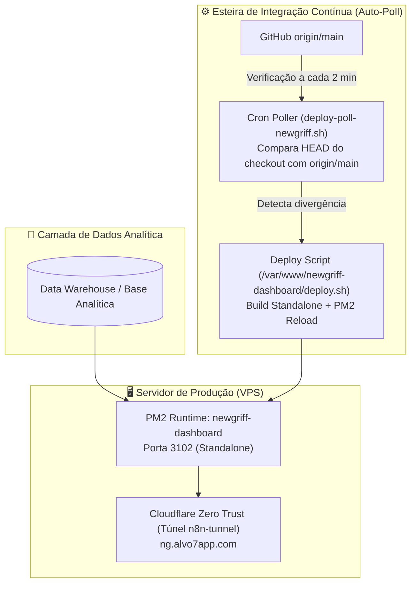

# 👔 New Griff — Business Intelligence & Controladoria

Bem-vindo ao hub central de tecnologia da **New Griff**. Esta organização reúne os repositórios, ferramentas analíticas e painéis executivos de Business Intelligence da marca.

---

## 🏛️ Topologia e Arquitetura de Deploy

---

## 📦 Repositórios

### 📊 [NewGriff](https://github.com/NewGriff-Alvo7App/NewGriff)
- **Função:** Plataforma completa de BI, Controladoria Financeira e Dashboard Executivo em Next.js 16.
- **Stack:** Next.js 16 (App Router, Standalone), TypeScript, Tailwind CSS, PM2 (`newgriff-dashboard`, porta 3102).
- **Acesso Público:** `ng.alvo7app.com` (via Cloudflare Zero Trust).
- **Ambientes:**
  - *Desenvolvimento (Workspace):* `/home/admapps/NewGriff` (porta 3103 em dev).
  - *Produção (Runtime):* `/var/www/newgriff-dashboard` (porta 3102).

---

## 🚀 Padrões de Desenvolvimento & Deploy

- **Branch Base:** `main`. Push direto na branch `main` é protegido pelo hook `pre-push`.
- **Deploy Automático:** O sistema de auto-polling sincroniza a `main` com produção em até 2 minutos após o merge do PR.
- **Commits:** Padronização com [Conventional Commits](https://www.conventionalcommits.org/).
